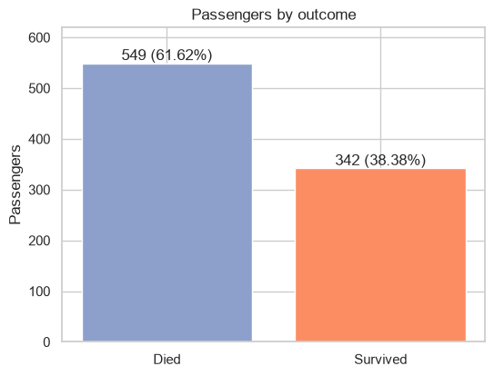
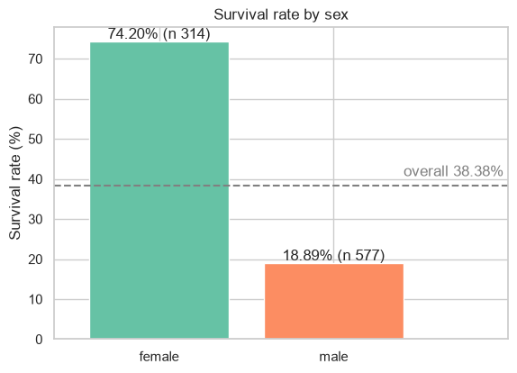
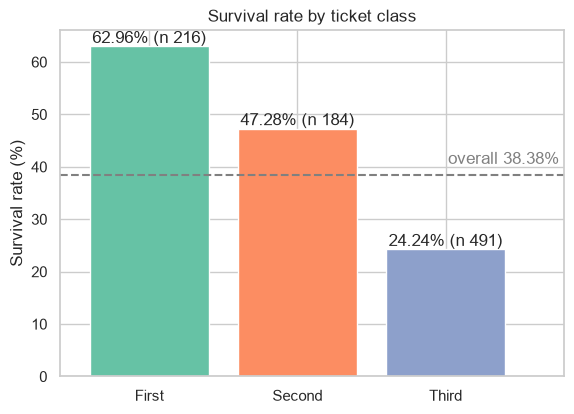
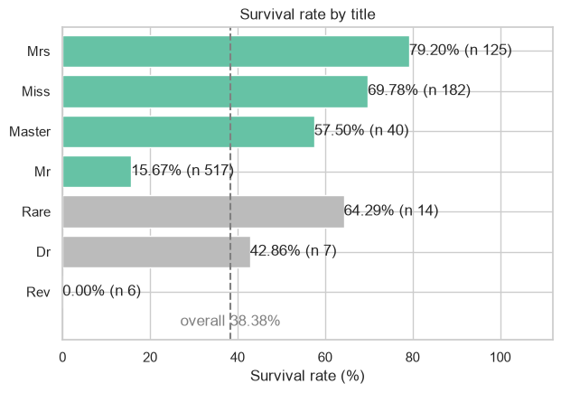
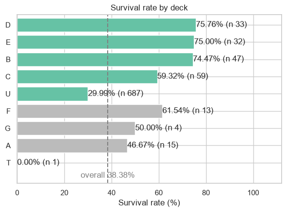

# Titanic Data Workflow: Module Summary

**Author:** Francisco Mateus

## 1. Overview

In this project, I constructed a reproducible data analysis workflow for Kaggle's [*Titanic: Machine Learning from Disaster*](https://www.kaggle.com/c/titanic/data) dataset (Kaggle, 2012) to examine how passenger
characteristics relate to survival, following a
structured approach to data ingestion, cleaning, exploratory analysis, visualization, and interpretation.

The analysis is implemented in `data_workflow.ipynb`, which contains the code, outputs, figures, and written conclusions in a single document. Following the principles described by Rule et al. (2019), the notebook is designed to make the analytical process understandable and reproducible, rather than presenting only
the final results.

The workflow begins by loading and validating the passenger data, then addresses missing values through four dedicated functions. It subsequently examines survival rates by sex, ticket class, title, and cabin deck, using descriptive tables and five labelled figures to support the findings. 
The report concludes by discussing the assumptions, limitations, and data-quality considerations that
affect the interpretation of the results.

## 2. Dataset Description

The dataset contains `891` passengers and `12` columns, with one row per passenger. The columns describe passenger characteristics, travel arrangements, and survival outcomes.

The analysis focuses on `Survived`, the binary outcome variable where `1` indicates survival and `0` indicates non-survival. The principal explanatory variables are `Sex` and `Pclass`, while passenger titles and cabin decks are
derived from `Name` and `Cabin`, respectively.

Three columns contain missing values:

| Column     | Missing values | Percentage |
| ---------- | -------------- | ---------- |
| `Age`      | `177`          | `19.87%`   |
| `Cabin`    | `687`          | `77.10%`   |
| `Embarked` | `2`            | `0.22%`    |

These gaps require different treatments because they differ in both magnitude and analytical significance. The notebook's Assessment section prints these same counts beside their share of the rows. Missing ages can be estimated from other passenger characteristics, missing cabin records substantially limit deck-level analysis, and the two missing embarkation ports can be filled using the most frequent category.

The input file, `titanic.csv`, is stored alongside the notebook. It mirrors the Titanic dataset distributed through the Kaggle competition and allows the workflow to run without downloading the data during execution.

## 3. Workflow Description

The workflow is divided into four stages: ingestion, cleaning, exploration, and visualization. The notebook's own section headings carry the same split, from Ingestion and Assessment through Cleaning, Exploratory Analysis and
Visualizations to a final Summary that consolidates the findings and documents the limitations. 
The notebook names each figure Visualization 1 through 5, and this report cites those same five figures as Figures 1 through 5.

### 3.1. Data ingestion and validation

Pandas loads `titanic.csv` from the notebook's directory. The initial validation checks that the dataset has the expected shape of `(891, 12)` and verifies the column data types. The Ingestion section also records the dataset's provenance.

These checks establish a baseline for the analysis and help detect unexpected changes to the input data before subsequent operations are performed.

### 3.2. Data cleaning

Four dedicated functions handle the transformations. Each function has a docstring and operates on a copy of the input DataFrame, avoiding unintended modifications to the original data.

- **`title_from_name`** extracts passenger titles from the `Name` column. Its pattern accommodates the captured form `the Countess` from the name `Rothes, the Countess.`, the one peerage entry in the table.

- **`fill_age`** replaces the missing ages with the median age of passengers sharing the same title. The overall median is used as a fallback if a title group has no available age observations, although this fallback is not required for the current dataset.

- **`deck_from_cabin`** extracts the initial letter of the cabin identifier and assigns `U` to passengers without a recorded cabin.

- **`fill_embarked`** replaces the two missing embarkation ports with `S`, the most frequent port in the dataset.

The Cleaning section's application cell reports the number of values filled and verifies that the cleaned fields contain no remaining missing values. 
The `deck` field uses `U` to represent passengers without recorded cabin information, while the original `Cabin` values remain missing, this to say that the Imputed ages are estimates rather than observed values.

### 3.3. Exploratory data analysis

The exploration uses a single function, `rate_table(df, col)`, to calculate the number of passengers, the number of survivors, and the survival rate for each category of a specified column.

The function is applied to `Sex`, `Pclass`, the grouped `title` view, and`deck`. 
The notebook's Exploratory Analysis section prints these tables together with the overall rate. They provide the numerical basis for the next interpretation and ensure that the reported survival rates can be traced back to the underlying group counts.

The analysis examines how survival differs between observed groups without fitting a predictive model or attempting to establish causal relationships.

### 3.4. Visualization

Five labelled figures present the principal results:

1. Overall passenger survival counts.
2. Survival rates by sex.
3. Survival rates by passenger class.
4. Survival rates by passenger title.
5. Survival rates by cabin deck.

Each figure is introduced by the question it addresses and followed by an interpretation in the notebook. 
Each figure cell also saves its PNG to the `figures/` directory, and this report embeds those saved files as Figures 1 through 5. The four survival-rate figures include a dashed reference line at the overall survival rate of `38.38%`, allowing group results to be compared against the dataset baseline.

Passenger classes remain in their natural order, while titles and decks are ordered by survival rate. Groups with limited observations are displayed in gray to distinguish descriptive results based on small samples from those
supported by larger groups.

## 4. Key Decisions and Assumptions

Each decision below is recorded in the notebook: the Assessment section states
what was kept, the Cleaning and Exploratory Analysis sections implement and print the rest, and the Summary section's Assumptions list gathers the imputation and derived-field choices in one place.

### 4.1. Age imputation

The `177` missing ages are filled using the median age within each passenger-title group, with the overall median as a fallback. This is the `fill_age` function of the notebook's Cleaning section.

Deleting these rows was also not a good solution as it would remove almost one-fifth of the dataset and could
change the composition of the groups being compared. Group-level median imputation retains all `891` passengers and uses an observable characteristic to estimate missing values.

However, this method assumes that passengers sharing a title have sufficiently similar age distributions for the group median to be informative. It also reduces the observed variability by assigning the same estimated value to
multiple passengers. As discussed by van Buuren (2018), single imputation does not fully represent uncertainty about missing values, therefore, the resulting ages must be treated as estimates rather than observations.

### 4.2. Missing cabin records

Rather than deleting `687` passengers, the analysis assigns them to a separate `U` category. This is referenced by  the `deck_from_cabin` function of the notebook's Cleaning section.

Thanks to this it's possible to preserve the full dataset for the overall analysis while making the
missingness visible. However, `U` is not a physical deck, and its survival rate cannot be interpreted as the survival rate of a particular area of the ship.
Deck-specific conclusions are restricted to the `204` passengers with recorded cabin information.

### 4.3. Embarkation ports and zero fares

The two missing embarkation ports are filled with `S`, which is also the most frequent category in the data. The notebook's Assessment section records that the two passengers shared one booking, ticket `113572`, which can provide additional context for the decision. The imputed values remain assumptions rather than verified observations.

Regarding the `15` zero fares these are retained because the analysis does not establish that they are invalid records. The notebook's Assessment section records both the counts and the decision to keep them. Removing unusual values without evidence that they are errors would introduce an additional assumption into the dataset.

### 4.4. Rare categories and sample size

Titles represented by two passengers or fewer are grouped into a `Rare` category for display purposes. This combines `11` titles covering `14` passengers. The underlying title column retains its original `17` distinct
values, so the grouping affects the presentation rather than the source data.
The notebook's Exploratory Analysis section prints the grouping, and its Summary section's Reflection block explains why such a small bucket cannot support a  comparison.

Groups with fewer than `20` passengers were treated as weak evidence and displayed in gray; the notebook applies this rule on its title and deck rate figures in the Visualizations section. This threshold is a descriptive reporting convention, not a statistical significance test. 
Small groups can produce highly variable survival rates, and their results should not be interpreted as reliable
estimates of broader population patterns.

### 4.5. Analytical scope

The analysis focuses on survival rates across selected passenger characteristics. It reports group sizes alongside rates to make the amount of supporting data visible and avoids moving directly from descriptive associations
to predictive or causal claims.

The resulting workflow provides a foundation for later modeling work, but it does not evaluate predictive performance, control for confounding variables, or determine the independent contribution of each characteristic to survival.

## 5. Results and Interpretation

### 5.1. Overall survival

**Figure 1 - Overall passenger survival**



Of the `891` passengers, `342` survived, corresponding to an overall survival rate of `38.38%`. This serves as the reference point for interpreting the differences between passenger groups.

### 5.2. Survival by sex

**Figure 2 - Survival rate by sex**



Women had a survival rate of `74.20%`, compared with `18.89%` for men. The difference between women and men is substantially larger than the difference observed between the passenger classes, making sex the most pronounced of the two primary comparisons.

The contrast indicates a strong association between sex and survival in this dataset. It is consistent with the accounts of women and children receiving priority during evacuation (Encyclopedia Titanica, 2026), which this analysis does not test; it cannot establish the mechanisms behind the difference or isolate the effect of sex from other passenger characteristics.

### 5.3. Survival by passenger class

**Figure 3 - Survival rate by passenger class**



Survival decreased across the three passenger classes:

- **First class:** `62.96%`.
- **Second class:** `47.28%`.
- **Third class:** `24.24%`.

First- and second-class passengers had survival rates above the overall baseline, while third-class passengers had a rate substantially below it. This ordered decline suggests that passenger class was associated with its ods of survival.
Passenger demographics, accommodation, and access to evacuation routes are possible explanations for the association, not findings established by this analysis.

### 5.4. Survival by passenger title

**Figure 4 - Survival rate by passenger title**



The title-based comparison provides additional detail about the differences observed by sex and offers a rough indication of life stage.

`Mrs` had a survival rate of `79.20%`, while `Miss` had a rate of `69.78%`. Both of these 
groups were well above the overall baseline. `Master`, that were commonly associated with boys, had a higher survival rate of `57.50%`, while `Mr` had a rate of `15.67%`.

These results show substantial differences between title groups. However, titles are imperfect proxies for demographic characteristics: they do not directly encode age, and they overlap with sex and social status. The title
analysis should therefore be interpreted as a more detailed descriptive breakdown, not as an independent explanation of survival.

The `Rare` category had a survival rate of `64.29%`, `Dr` `42.86%`, and `Rev` `0.00%`. As per my analysis, these groups contain too few observations to support strong comparisons, so their rates are presented as descriptive results rather than general patterns.

### 5.5. Survival by cabin deck

**Figure 5 - Survival rate by cabin deck**



Among passengers with recorded cabin information, decks `D`, `E`, and `B` had survival rates of `75.76%`, `75.00%`, and `74.47%`, respectively. Deck `C` followed at `59.32%`.

The rates for `F` (`61.54%`), `G` (`50.00%`), `A` (`46.67%`), and `T` (`0.00%`) are less informative because these categories contain relatively few passengers, with `T` represented by a single passenger.

Passengers assigned to `U`, representing the `687` missing cabin records, had a survival rate of `29.99%`. This result describes passengers whose cabin location was not recorded in the dataset. It must not be interpreted as a deck-level survival rate or used to conclude that passengers on a particular deck were more or less likely to survive.

The recorded-deck results suggest differences between cabin locations, but with `687` of `891` cabin records absent, these findings do not extend confidently to all passengers.

## 6. Responsible Practice: Bias and Data Quality

The reliability of the findings depends on how missing values, unusual records, and small groups are handled, from which several limitations are particularly relevant:

**Missing data can introduce bias.** The absence of age information may not be random. Removing passengers with missing ages could change the composition of the analyzed population, while median imputation introduces its own assumptions.
Retaining the passengers is useful, but it does not eliminate uncertainty about their actual ages.

**Cabin information is incomplete.** With `77.10%` of cabin records missing, deck-level analysis is based on a small subset of the full dataset. The separate `U` category preserves visibility of the missing records without treating missingness as a physical location.

**Unusual observations should not be removed without justification.** The `15` zero fares remain in the data because their validity has not been disproved.
This avoids making unsupported corrections solely to produce cleaner-looking results.

**Small groups require cautious interpretation.** Survival rates based on very few passengers can change substantially with a single observation. The gray presentation of small groups makes this limitation visible, but it does not replace formal uncertainty estimates.

**Association is not causation.** The dataset describes one historical voyage, and the analysis is observational. The reported differences identify patterns in the available records; they do not establish that any single characteristic caused a passenger to survive.

The notebook's Summary section carries the same points as its Limitations and Assumptions lists.

## 7. Reproducibility

The workflow uses a fixed local input, `titanic.csv`, stored alongside `data_workflow.ipynb`. The notebook validates the expected dataset shape, documents the transformations, and includes the outputs and narrative needed to follow the analysis.

The project includes a `requirements.txt` file generated from the environment used to produce the stored outputs. It records the environment's installed packages, while the notebook's setup cell identifies the four principal analysis libraries and their recorded versions:

- NumPy `2.5.3`
- pandas `3.0.6`
- Matplotlib `3.11.2`
- seaborn `0.13.2`

The environment that produced the stored outputs runs Python `3.13.15`, the version the notebook's setup cell prints beside the library versions. The interpreter version is recorded here because the title extraction calls
`str.removeprefix()`, a method available only from Python `3.9` onward.

The version-control history contains commits corresponding to the individual sections of the work on a development branch alongside the default branch, making the development process inspectable. The repository and its
full commit history are public at https://github.com/intend-dev/ai-programming-foundations-project.

To recreate the environment and execute the notebook, run the following commands from the project directory:

```bash
uv venv --python 3.13 .venv
uv pip install --python .venv -r requirements.txt
.venv\Scripts\python.exe -m nbconvert --to notebook --execute --inplace data_workflow.ipynb
```

The `--python 3.13` flag pins the interpreter major version that the commands in this section rely on. On macOS and Linux the last command reads `.venv/bin/python` instead, and `--clear` replaces an existing `.venv`. The standard-library equivalent (`python -m venv`, activate, `pip install -r requirements.txt`) is documented as Alternative Setup in the repository's README.

The data_workflow.ipynb notebook is designed to run without internet access once the required packages and input file are available. Package pinning and a self-contained analytical document support reproducibility, in line with the practices discussed by Danchev (2022).

A clean execution in the documented environment remains the practical test that the workflow reproduces its stored outputs. The package list and notebook structure support that goal but do not, by themselves, guarantee identical
results across all operating systems or software environments.

## 8. Conclusion

The analysis identifies substantial differences in Titanic survival rates by `sex`, passenger `class`, `title`, and recorded `cabin` deck. `Women` had a markedly higher survival rate than `men`, survival declined across passenger   `classes`, and several recorded `cabin` decks had rates above the overall baseline. The title breakdown further illustrates differences between demographic groups, although titles overlap with other characteristics and should not be treated as independent explanatory variables.

The main contribution of the project is the transparent and reproducible data workflow I built. Missing values are handled explicitly, unusual records are retained unless there is evidence to remove them, group sizes accompany survival rates, and small categories are presented cautiously.

The findings remain descriptive and are constrained by the incomplete cabin records, assumptions introduced through age imputation, and the limited size of some groups. Further work could examine relationships between variables
simultaneously, compare alternative imputation methods, quantify uncertainty around survival rates, and develop predictive models evaluated on data not used during training.

## 9. Sources and Citations

Danchev, V. (2022). Reproducible Data Science with Python: An Open Learning Resource. *Journal of Open Source Education, 5*(56), 156.
[https://doi.org/10.21105/jose.00156](https://doi.org/10.21105/jose.00156)

Encyclopedia Titanica. (2026). *Martha M. Stone*.
[https://www.encyclopedia-titanica.org/titanic-survivor/martha-stone.html](https://www.encyclopedia-titanica.org/titanic-survivor/martha-stone.html)

Kaggle. (2012). *Titanic - Machine Learning from Disaster*.
[https://www.kaggle.com/c/titanic/data](https://www.kaggle.com/c/titanic/data)

Rule, A., Birmingham, A., Zuniga, C., Altintas, I., Huang, S.-C., Knight, R., Moshiri, N., Nguyen, M. H., Rosenthal, S. B., Pérez, F., & Rose, P. W. (2019).
Ten Simple Rules for Writing and Sharing Computational Analyses in Jupyter Notebooks. *PLOS Computational Biology, 15*(7), e1007007.
[https://doi.org/10.1371/journal.pcbi.1007007](https://doi.org/10.1371/journal.pcbi.1007007)

van Buuren, S. (2018). *Flexible Imputation of Missing Data* (2nd ed.). CRC Press. [https://stefvanbuuren.name/fimd/](https://stefvanbuuren.name/fimd/)

**Additional provenance notes:** The course provides no file template for this written summary, so the report follows the required section list for this module, arranged the way the provided notebook templates of my earlier Communicate Data Findings project arrange things. The course-supplied copy of the Danchev article, used as the course locator, is available at
[https://www.researchgate.net/publication/364706809_Reproducible_Data_Science_with_Python_An_Open_Learning_Resource](https://www.researchgate.net/publication/364706809_Reproducible_Data_Science_with_Python_An_Open_Learning_Resource).
The DOI above is the canonical citation. The shipped `titanic.csv` mirrors the
dataset available at
[https://raw.githubusercontent.com/datasciencedojo/datasets/master/titanic.csv](https://raw.githubusercontent.com/datasciencedojo/datasets/master/titanic.csv),
as recorded in the notebook's Ingestion section.
